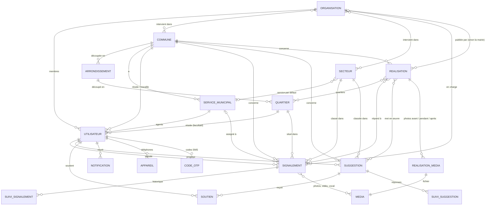

# Voix du Citoyen — documentation de la base de données

*Au 27 octobre 2026 · PostgreSQL 17 · générée à partir du code (modèles Django).*
Structure SQL complète : [`base_de_donnees.sql`](base_de_donnees.sql).

## 1. Vue d'ensemble

La base sert **une seule API** utilisée par trois clients : l'application mobile des
citoyens, l'interface web des organisations (ONG, OSC) et l'interface web de la mairie.
Elle compte **18 tables métier**, réparties en 8 domaines, plus les tables techniques de
Django (sessions, permissions, jetons de connexion).

| Domaine | Tables | Rôle |
|---|---|---|
| Territoire | Commune, Arrondissement, Quartier | Découpage administratif (Parakou : 3 arrondissements, 58 quartiers) |
| Comptes et organisations | Utilisateur, Organisation, Service municipal, Code OTP, Appareil | Citoyens, agents et admins mairie, ONG, codes SMS, téléphones pour les notifications |
| Référentiel | Secteur | Thèmes communs à toutes les communes (voirie, santé, éducation…) |
| Médias | Média | Photos, vidéos et messages vocaux envoyés |
| Signalements | Signalement, Suivi de signalement | Problèmes signalés par les citoyens et leur historique de traitement |
| Suggestions | Suggestion, Soutien, Suivi de suggestion | Idées des citoyens, soutiens des voisins, réponses de la mairie |
| Réalisations | Réalisation, Média de réalisation | Travaux publiés par la mairie et par les organisations |
| Notifications | Notification | Messages envoyés aux utilisateurs (dans l'application et sur le téléphone) |

Conventions : chaque table a un identifiant `id` et deux dates automatiques, `cree_le`
(création) et `maj_le` (dernière modification). Les médias ont un identifiant UUID.
**Rien ne se supprime** dans le référentiel : on désactive (`actif = false`).

## 2. Schéma des relations

## 3. Règles importantes portées par la base

- **Rôles des utilisateurs** (`accounts_utilisateur.role`) : `CITOYEN` (mobile, connexion par
  téléphone), `AGENT` et `ADMIN_MAIRIE` (web mairie), `ORGANISATION` (web ONG). La mairie et les
  organisations se connectent par e-mail.
- **Anonymat** : le lien vers l'auteur d'un signalement ou d'une suggestion est conservé en base,
  mais l'API ne le montre **à personne d'autre que l'auteur**, mairie comprise.
- **Plusieurs communes** : signalements, suggestions et réalisations portent leur `commune` ;
  chaque mairie ne voit que la sienne.
- **Périmètre d'une organisation** : ses communes et secteurs d'intervention (tables de liaison
  `accounts_organisation_communes` et `accounts_organisation_secteurs`). Elle ne voit que les
  signalements qui y correspondent.
- **Cycle d'un signalement** (`statut`) : `SOUMIS → RECU → EN_COURS → RESOLU`, ou `REJETE` /
  `DOUBLON`. Une seule organisation peut en être chargée (`organisation_assignee_id`).
- **Historique** : chaque changement de statut, assignation ou réponse ajoute une ligne dans
  `signalements_suivisignalement` (les notes internes ne sont visibles que de la mairie).
- **Réalisations** : `organisation_id` vide = réalisation de la mairie ; renseigné = réalisation
  de cette organisation. Les brouillons (`publie = false`) ne sont visibles que par leur auteur.
- **Contraintes en base** : description écrite ou vocale obligatoire pour un signalement,
  coordonnées obligatoires en mode GPS, un seul soutien par citoyen et par suggestion, e-mail
  unique et obligatoire pour la mairie et les organisations, etc. (listées sous chaque table).
- **Sécurité** : les codes SMS ne sont jamais stockés en clair (`code_hash`), les photos sont
  débarrassées de leurs métadonnées (position GPS, appareil) à l'enregistrement.

## 4. Détail des tables

Légende des types : « → table » = lien vers une ligne d'une autre table ; « ↔ table (plusieurs) »
= liens multiples (table de liaison) ; « suppression : PROTECT » = impossible de supprimer la
ligne liée tant qu'elle est utilisée, « CASCADE » = supprimée avec elle, « SET_NULL » = le lien
est vidé.

### Territoire (`territoire`)

#### `territoire_commune` — Commune

| Champ | Type | Obligatoire | Remarques |
|---|---|---|---|
| `id` | entier (clé) | automatique | clé primaire |
| `cree_le` | date et heure | automatique |  |
| `maj_le` | date et heure | automatique |  |
| `nom` | texte (100) | oui |  |
| `code` | texte (20) | oui | unique |
| `departement` | texte (100) | oui |  |
| `lat_min` | décimal (9,6) | oui |  |
| `lat_max` | décimal (9,6) | oui |  |
| `lng_min` | décimal (9,6) | oui |  |
| `lng_max` | décimal (9,6) | oui |  |

#### `territoire_arrondissement` — Arrondissement

| Champ | Type | Obligatoire | Remarques |
|---|---|---|---|
| `id` | entier (clé) | automatique | clé primaire |
| `cree_le` | date et heure | automatique |  |
| `maj_le` | date et heure | automatique |  |
| `commune_id` | → territoire_commune | oui | suppression : PROTECT |
| `nom` | texte (100) | oui |  |
| `code` | texte (20) | oui |  |

Contraintes : `arrondissement_unique_par_commune`

#### `territoire_quartier` — Quartier

| Champ | Type | Obligatoire | Remarques |
|---|---|---|---|
| `id` | entier (clé) | automatique | clé primaire |
| `cree_le` | date et heure | automatique |  |
| `maj_le` | date et heure | automatique |  |
| `arrondissement_id` | → territoire_arrondissement | oui | suppression : PROTECT |
| `nom` | texte (100) | oui |  |
| `code` | texte (20) | oui |  |
| `latitude_centre` | décimal (9,6) | non |  |
| `longitude_centre` | décimal (9,6) | non |  |
| `actif` | oui/non | oui |  |

Contraintes : `quartier_unique_par_arrondissement`

### Comptes et organisations (`accounts`)

#### `accounts_utilisateur` — Utilisateur

| Champ | Type | Obligatoire | Remarques |
|---|---|---|---|
| `id` | entier (clé) | automatique | clé primaire |
| `cree_le` | date et heure | automatique |  |
| `maj_le` | date et heure | automatique |  |
| `telephone` | téléphone (E.164) | oui | unique |
| `nom` | texte (100) | oui |  |
| `prenoms` | texte (150) | oui |  |
| `email` | e-mail | non | Identifiant de connexion de la mairie et des organisations ; facultatif pour les citoyens. |
| `role` | texte (20) | oui | choix : `CITOYEN`, `AGENT`, `ADMIN_MAIRIE`, `ORGANISATION` |
| `commune_id` | → territoire_commune | non | suppression : PROTECT ; Citoyen : commune choisie à l'inscription. Agent / admin : commune de sa mairie (vide pour un admin de la plateforme, qui voit toutes les communes). |
| `quartier_residence_id` | → territoire_quartier | non | suppression : SET_NULL |
| `organisation_id` | → accounts_organisation | non | suppression : PROTECT |
| `service_id` | → accounts_servicemunicipal | non | suppression : PROTECT |
| `telephone_verifie` | oui/non | oui |  |
| `is_active` | oui/non | oui |  |
| `is_staff` | oui/non | oui |  |
| `date_joined` | date et heure | oui |  |

Contraintes : `utilisateur_agent_avec_service`, `utilisateur_organisation_avec_organisation`, `utilisateur_agent_avec_commune`, `utilisateur_personnel_avec_email`, `utilisateur_email_unique`

#### `accounts_organisation` — Organisation

| Champ | Type | Obligatoire | Remarques |
|---|---|---|---|
| `id` | entier (clé) | automatique | clé primaire |
| `cree_le` | date et heure | automatique |  |
| `maj_le` | date et heure | automatique |  |
| `nom` | texte (200) | oui |  |
| `sigle` | texte (50) | non |  |
| `type` | texte (10) | oui | choix : `ONG`, `OSC`, `AUTRE` |
| `numero_enregistrement` | texte (100) | oui | unique |
| `email` | e-mail | non |  |
| `telephone` | téléphone (E.164) | non |  |
| `adresse` | texte (255) | non |  |
| `logo` | image | non |  |
| `statut_habilitation` | texte (20) | oui | choix : `HABILITEE`, `SUSPENDUE` |
| `motif_suspension` | texte long | non | Obligatoire quand l'organisation est suspendue, vidé à la réhabilitation. |
| `date_habilitation` | date | automatique |  |
| `habilitee_par_id` | → accounts_utilisateur | automatique | suppression : SET_NULL |
| `date_expiration` | date | non | Laisser vide pour une habilitation sans limite. |
| `secteurs` | ↔ referentiel_secteur (plusieurs) | non | L'organisation ne voit que les signalements de ces secteurs (aucun secteur : aucun signalement). |
| `communes` | ↔ territoire_commune (plusieurs) | non | L'organisation ne voit que les signalements de ces communes (aucune commune : aucun signalement). |

Contraintes : `organisation_suspension_avec_motif`

#### `accounts_servicemunicipal` — Service municipal

| Champ | Type | Obligatoire | Remarques |
|---|---|---|---|
| `id` | entier (clé) | automatique | clé primaire |
| `cree_le` | date et heure | automatique |  |
| `maj_le` | date et heure | automatique |  |
| `commune_id` | → territoire_commune | oui | suppression : PROTECT |
| `nom` | texte (150) | oui |  |
| `description` | texte long | non |  |
| `responsable_id` | → accounts_utilisateur | non | suppression : SET_NULL |
| `actif` | oui/non | oui |  |

Contraintes : `service_unique_par_commune`

#### `accounts_codeotp` — Code OTP

| Champ | Type | Obligatoire | Remarques |
|---|---|---|---|
| `id` | entier (clé) | automatique | clé primaire |
| `cree_le` | date et heure | automatique |  |
| `maj_le` | date et heure | automatique |  |
| `utilisateur_id` | → accounts_utilisateur | oui | suppression : CASCADE |
| `code_hash` | texte (128) | oui |  |
| `motif` | texte (30) | oui | choix : `INSCRIPTION`, `REINITIALISATION_MDP` |
| `expire_le` | date et heure | oui |  |
| `tentatives` | entier ≥ 0 | oui |  |
| `utilise` | oui/non | oui |  |

#### `accounts_appareil` — Appareil

| Champ | Type | Obligatoire | Remarques |
|---|---|---|---|
| `id` | entier (clé) | automatique | clé primaire |
| `cree_le` | date et heure | automatique |  |
| `maj_le` | date et heure | automatique |  |
| `utilisateur_id` | → accounts_utilisateur | oui | suppression : CASCADE |
| `token_fcm` | texte (255) | oui | unique |
| `plateforme` | texte (10) | oui | choix : `ANDROID`, `IOS` |
| `actif` | oui/non | oui |  |

### Référentiel (`referentiel`)

#### `referentiel_secteur` — Secteur

| Champ | Type | Obligatoire | Remarques |
|---|---|---|---|
| `id` | entier (clé) | automatique | clé primaire |
| `cree_le` | date et heure | automatique |  |
| `maj_le` | date et heure | automatique |  |
| `nom` | texte (100) | oui | unique |
| `code` | texte (30) | oui | unique |
| `description` | texte long | non |  |
| `icone` | texte (50) | non | Nom de l'icône affichée par les applications. |
| `couleur` | texte (7) | non |  |
| `pour_signalement` | oui/non | oui |  |
| `pour_suggestion` | oui/non | oui |  |
| `pour_realisation` | oui/non | oui |  |
| `service_par_defaut_id` | → accounts_servicemunicipal | non | suppression : SET_NULL ; Service auquel les nouveaux signalements de ce secteur sont assignés. |
| `ordre` | entier ≥ 0 | oui |  |
| `actif` | oui/non | oui |  |

### Médias (`medias`)

#### `medias_media` — Média

| Champ | Type | Obligatoire | Remarques |
|---|---|---|---|
| `cree_le` | date et heure | automatique |  |
| `maj_le` | date et heure | automatique |  |
| `id` | UUID | automatique | clé primaire |
| `auteur_id` | → accounts_utilisateur | oui | suppression : PROTECT |
| `type` | texte (10) | oui | choix : `IMAGE`, `VIDEO`, `AUDIO` |
| `fichier` | fichier | oui |  |
| `miniature` | image | non |  |
| `mime_type` | texte (100) | oui |  |
| `taille_octets` | entier ≥ 0 | oui |  |
| `duree_secondes` | entier ≥ 0 | non |  |
| `largeur` | entier ≥ 0 | non |  |
| `hauteur` | entier ≥ 0 | non |  |
| `statut` | texte (20) | oui | choix : `TEMPORAIRE`, `ATTACHE` |

### Signalements (`signalements`)

#### `signalements_signalement` — Signalement

| Champ | Type | Obligatoire | Remarques |
|---|---|---|---|
| `id` | entier (clé) | automatique | clé primaire |
| `cree_le` | date et heure | automatique |  |
| `maj_le` | date et heure | automatique |  |
| `reference` | texte (20) | automatique | unique |
| `commune_id` | → territoire_commune | oui | suppression : PROTECT ; Commune de l'auteur au moment de l'envoi (déduite du compte, jamais envoyée). |
| `titre` | texte (150) | non |  |
| `titre_genere` | oui/non | oui |  |
| `description_texte` | texte long | non |  |
| `description_audio_id` | → medias_media | non | unique ; suppression : PROTECT |
| `secteur_id` | → referentiel_secteur | oui | suppression : PROTECT |
| `auteur_id` | → accounts_utilisateur | oui | suppression : PROTECT |
| `mode_localisation` | texte (10) | oui | choix : `GPS`, `MANUEL` |
| `latitude` | décimal (9,6) | non |  |
| `longitude` | décimal (9,6) | non |  |
| `precision_gps` | entier ≥ 0 | non |  |
| `quartier_id` | → territoire_quartier | oui | suppression : PROTECT |
| `repere` | texte (255) | non |  |
| `statut` | texte (20) | oui | choix : `SOUMIS`, `RECU`, `EN_COURS`, `RESOLU`, `REJETE`, `DOUBLON` |
| `service_assigne_id` | → accounts_servicemunicipal | non | suppression : SET_NULL |
| `agent_assigne_id` | → accounts_utilisateur | non | suppression : SET_NULL |
| `organisation_assignee_id` | → accounts_organisation | non | suppression : SET_NULL |
| `doublon_de_id` | → signalements_signalement | non | suppression : SET_NULL |
| `date_resolution` | date et heure | non |  |
| `medias` | ↔ medias_media (plusieurs) | non |  |

Contraintes : `signalement_avec_description`, `signalement_gps_complet`

#### `signalements_suivisignalement` — Suivi de signalement

| Champ | Type | Obligatoire | Remarques |
|---|---|---|---|
| `id` | entier (clé) | automatique | clé primaire |
| `cree_le` | date et heure | automatique |  |
| `maj_le` | date et heure | automatique |  |
| `signalement_id` | → signalements_signalement | oui | suppression : CASCADE |
| `type_evenement` | texte (20) | oui | choix : `CHANGEMENT_STATUT`, `ASSIGNATION`, `REPONSE`, `NOTE_INTERNE` |
| `ancien_statut` | texte (20) | non | choix : `SOUMIS`, `RECU`, `EN_COURS`, `RESOLU`, `REJETE`, `DOUBLON` |
| `nouveau_statut` | texte (20) | non | choix : `SOUMIS`, `RECU`, `EN_COURS`, `RESOLU`, `REJETE`, `DOUBLON` |
| `commentaire` | texte long | non |  |
| `visible_citoyen` | oui/non | oui |  |
| `auteur_id` | → accounts_utilisateur | oui | suppression : PROTECT |

Contraintes : `suivi_signalement_note_interne_invisible`

### Suggestions (`suggestions`)

#### `suggestions_suggestion` — Suggestion

| Champ | Type | Obligatoire | Remarques |
|---|---|---|---|
| `id` | entier (clé) | automatique | clé primaire |
| `cree_le` | date et heure | automatique |  |
| `maj_le` | date et heure | automatique |  |
| `reference` | texte (20) | automatique | unique |
| `commune_id` | → territoire_commune | oui | suppression : PROTECT ; Commune de l'auteur au moment de l'envoi (déduite du compte, jamais envoyée). |
| `titre` | texte (150) | oui |  |
| `description` | texte long | oui |  |
| `secteur_id` | → referentiel_secteur | oui | suppression : PROTECT |
| `quartier_id` | → territoire_quartier | non | suppression : PROTECT ; Vide : la suggestion concerne toute la commune. |
| `auteur_id` | → accounts_utilisateur | oui | suppression : PROTECT |
| `est_pertinente` | oui/non | oui |  |
| `nb_soutiens` | entier ≥ 0 | oui |  |
| `reponse_officielle` | texte long | non |  |
| `repondu_par_id` | → accounts_utilisateur | non | suppression : SET_NULL |
| `repondu_le` | date et heure | non |  |
| `medias` | ↔ medias_media (plusieurs) | non |  |

#### `suggestions_soutien` — Soutien

| Champ | Type | Obligatoire | Remarques |
|---|---|---|---|
| `id` | entier (clé) | automatique | clé primaire |
| `cree_le` | date et heure | automatique |  |
| `maj_le` | date et heure | automatique |  |
| `suggestion_id` | → suggestions_suggestion | oui | suppression : CASCADE |
| `citoyen_id` | → accounts_utilisateur | oui | suppression : CASCADE |

Contraintes : `soutien_unique_par_citoyen`

#### `suggestions_suivisuggestion` — Suivi de suggestion

| Champ | Type | Obligatoire | Remarques |
|---|---|---|---|
| `id` | entier (clé) | automatique | clé primaire |
| `cree_le` | date et heure | automatique |  |
| `maj_le` | date et heure | automatique |  |
| `suggestion_id` | → suggestions_suggestion | oui | suppression : CASCADE |
| `type_evenement` | texte (20) | oui | choix : `REPONSE`, `NOTE_INTERNE` |
| `commentaire` | texte long | non |  |
| `visible_citoyen` | oui/non | oui |  |
| `auteur_id` | → accounts_utilisateur | oui | suppression : PROTECT |

Contraintes : `suivi_suggestion_note_interne_invisible`

### Réalisations (`realisations`)

#### `realisations_realisation` — Réalisation

| Champ | Type | Obligatoire | Remarques |
|---|---|---|---|
| `id` | entier (clé) | automatique | clé primaire |
| `cree_le` | date et heure | automatique |  |
| `maj_le` | date et heure | automatique |  |
| `reference` | texte (20) | automatique | unique |
| `commune_id` | → territoire_commune | oui | suppression : PROTECT |
| `titre` | texte (200) | oui |  |
| `description` | texte long | oui |  |
| `secteur_id` | → referentiel_secteur | oui | suppression : PROTECT |
| `statut` | texte (20) | oui | choix : `PLANIFIEE`, `EN_COURS`, `TERMINEE`, `SUSPENDUE` |
| `taux_avancement` | entier ≥ 0 | oui |  |
| `date_debut_prevue` | date | non |  |
| `date_fin_prevue` | date | non |  |
| `date_debut_reelle` | date | non |  |
| `date_fin_reelle` | date | non |  |
| `budget` | décimal (14,0) | non |  |
| `source_financement` | texte (255) | non |  |
| `prestataire` | texte (255) | non |  |
| `latitude` | décimal (9,6) | non |  |
| `longitude` | décimal (9,6) | non |  |
| `publie` | oui/non | oui |  |
| `cree_par_id` | → accounts_utilisateur | oui | suppression : PROTECT |
| `organisation_id` | → accounts_organisation | non | suppression : PROTECT |
| `quartiers` | ↔ territoire_quartier (plusieurs) | non |  |
| `signalements` | ↔ signalements_signalement (plusieurs) | non |  |
| `suggestions` | ↔ suggestions_suggestion (plusieurs) | non |  |

Contraintes : `realisation_taux_max_100`, `realisation_dates_prevues_ordonnees`, `realisation_dates_reelles_ordonnees`, `realisation_position_complete`, `realisation_budget_positif`

#### `realisations_realisationmedia` — Média de réalisation

| Champ | Type | Obligatoire | Remarques |
|---|---|---|---|
| `id` | entier (clé) | automatique | clé primaire |
| `cree_le` | date et heure | automatique |  |
| `maj_le` | date et heure | automatique |  |
| `realisation_id` | → realisations_realisation | oui | suppression : CASCADE |
| `media_id` | → medias_media | oui | unique ; suppression : CASCADE |
| `phase` | texte (10) | oui | choix : `AVANT`, `PENDANT`, `APRES` |
| `legende` | texte (255) | non |  |
| `ordre` | entier ≥ 0 | oui |  |

### Notifications (`notifications`)

#### `notifications_notification` — Notification

| Champ | Type | Obligatoire | Remarques |
|---|---|---|---|
| `id` | entier (clé) | automatique | clé primaire |
| `cree_le` | date et heure | automatique |  |
| `maj_le` | date et heure | automatique |  |
| `destinataire_id` | → accounts_utilisateur | oui | suppression : CASCADE |
| `type` | texte (30) | oui | choix : `STATUT_SIGNALEMENT`, `REPONSE_SIGNALEMENT`, `REPONSE_SUGGESTION`, `NOUVELLE_REALISATION`, `NOUVEAU_SIGNALEMENT`, `AFFECTATION_SIGNALEMENT` |
| `titre` | texte (150) | oui |  |
| `message` | texte long | oui |  |
| `cible_type` | texte (20) | oui | choix : `signalement`, `suggestion`, `realisation` |
| `cible_id` | entier | oui |  |
| `lu` | oui/non | oui |  |
| `envoye_push` | oui/non | oui |  |

## 5. Tables techniques (Django)

Créées et gérées automatiquement par le framework, sans logique métier :
`django_migrations` (historique des évolutions de la base), `django_content_type`,
`auth_permission`, `auth_group` et leurs liaisons (permissions de l'administration),
`django_admin_log` (journal de l'administration), `django_session` (sessions de
l'administration), `token_blacklist_outstandingtoken` et `token_blacklist_blacklistedtoken`
(jetons de connexion émis et révoqués), et en production `cache_django` (limitation du nombre
de requêtes).
